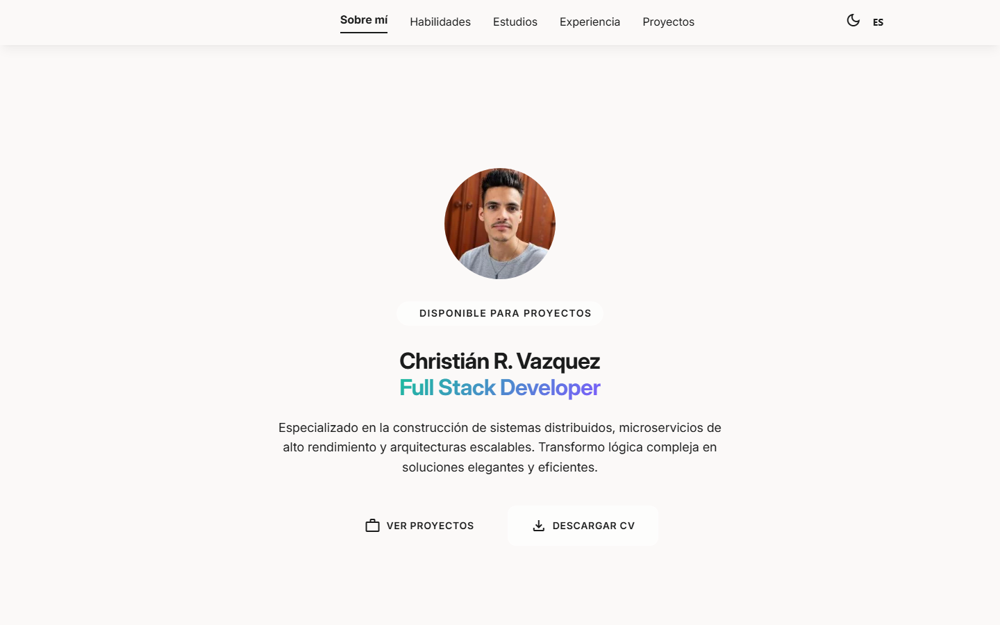

<div align="center">

# Christián R. Vazquez — Portafolio

**Portafolio profesional estático de un Full Stack Developer (Java/Spring, PHP/Symfony, React).**

[](https://christianrvdv.netlify.app/)
[](https://christianrvdv.github.io/christianrvdv/)
[](#stack)
[](#stack)

**Producción:** [christianrvdv.netlify.app](https://christianrvdv.netlify.app/) · espejo en [christianrvdv.github.io/christianrvdv](https://christianrvdv.github.io/christianrvdv/)



</div>

---

## Sobre este sitio

Cuatro páginas, un solo árbol de archivos, desplegada en dos hosts sin build por host:

| Ruta | Contenido |
|---|---|
| `/` | Portafolio SPA: sobre mí, habilidades, estudios, experiencia, proyectos, contacto |
| `/cv/` | CV interactivo (ES) con impresión y descarga de PDF |
| `/cv/en/` | CV interactivo (EN) |
| `/cv/ats/` | CV ATS minimalista (CSS inline, pensado para sistemas de reclutamiento) |

El sitio es **100 % cliente**: sin backend, sin frameworks, sin CDNs externos. Fuentes e iconos están auto-hospedados en subconjunto (`assets/fonts/`) para minimizar el peso.

## Stack

- **HTML5** semántico (`<main>`, landmarks, `data-i18n` para traducción)
- **Tailwind CSS v3** compilado desde `src/styles/input.css` → `assets/css/main.css` (tokens de diseño en `src/styles/tokens.css`, dark mode por clase)
- **JavaScript vanilla** con módulos ES (`assets/js/main.js` + `assets/js/modules/`)
- **i18n** por diccionarios JSON (`assets/i18n/`) con anti-FOUC por pre-render del texto
- **Playwright** (solo devDependency) para exportar los PDFs del CV de forma reproducible

## Desarrollo

```bash
npm install          # única vez
npm run dev          # watch de CSS + servidor estático en http://localhost:3000
npm run build:css    # build de producción de CSS (Netlify ejecuta esto en cada deploy)
npm run build:cv     # regenera los 3 PDFs del CV (Playwright headless)
npm run lint:html    # html-validate sobre index.html + cv/**
```

`assets/css/main.css` es output generado y **se commitea** (GitHub Pages no builda): tras tocar `src/styles/` o `tailwind.config.js`, ejecuta `npm run build:css` y commitea el resultado. No edites `main.css` a mano.

## Estructura

```
christianrvdv/
├── index.html                  # portafolio SPA
├── netlify.toml                # redirects 301 legacy + headers de cache/seguridad
├── tailwind.config.js          # tokens → utilidades Tailwind
├── cv/
│   ├── index.html              # CV interactivo (ES)
│   ├── en/index.html           # CV interactivo (EN)
│   └── ats/index.html          # CV ATS (CSS inline)
├── src/styles/
│   ├── input.css               # fuente del build Tailwind
│   └── tokens.css              # variables de diseño (:root + .dark)
├── assets/
│   ├── css/                    # main.css (generado), cv.css, vendor/
│   ├── js/                     # main.js, cv.js, modules/ (i18n, theme, navbar…)
│   ├── i18n/                   # portfolio.{es,en}.json, cv.{es,en}.json
│   ├── fonts/                  # Inter + subsets FA/Material Symbols (woff2)
│   ├── images/                 # avatar, proyectos, og-preview.jpg
│   └── docs/                   # PDFs exportados del CV
├── scripts/
│   ├── dev.mjs                 # dev server + watch
│   ├── serve.mjs               # servidor estático
│   └── build-cv.mjs            # export de PDFs con Playwright
└── docs/                       # SPEC, CONSTRAINTS, ARCHITECTURE, ADRs, verificación
```

## Despliegue dual

El mismo árbol sirve en Netlify (raíz del dominio) y en GitHub Pages (subpath `/christianrvdv/`) gracias a **rutas relativas** en HTML/CSS/JS (ADR-007 y ADR-009). Los 301s de URLs históricas (`/cv-en`, `/estilo.css`, …) viven en `netlify.toml` y solo aplican en Netlify. Las metas Open Graph apuntan a URLs absolutas de Netlify para que las previews de compartir link carguen desde cualquier host.

## Créditos

- **Inter** — Rasmus Andersson, [SIL Open Font License 1.1](https://openfontlicense.org/)
- **Material Symbols** — Google, [Apache License 2.0](https://www.apache.org/licenses/LICENSE-2.0)
- **Font Awesome Free** (iconos, subset local) — [CC BY 4.0](https://creativecommons.org/licenses/by/4.0/)
- Fotografía, avatar y `og-preview.jpg`: activos propios.

---

<div align="center">

[](https://github.com/christianrvdv)
[](mailto:christianrvdv.1999@gmail.com)
[](https://t.me/christianrvdv)

</div>
